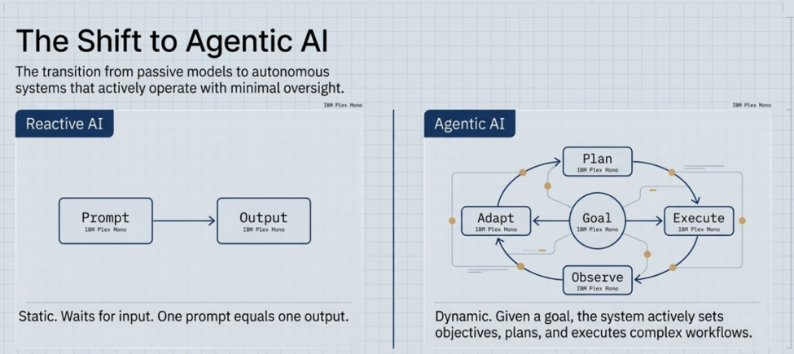
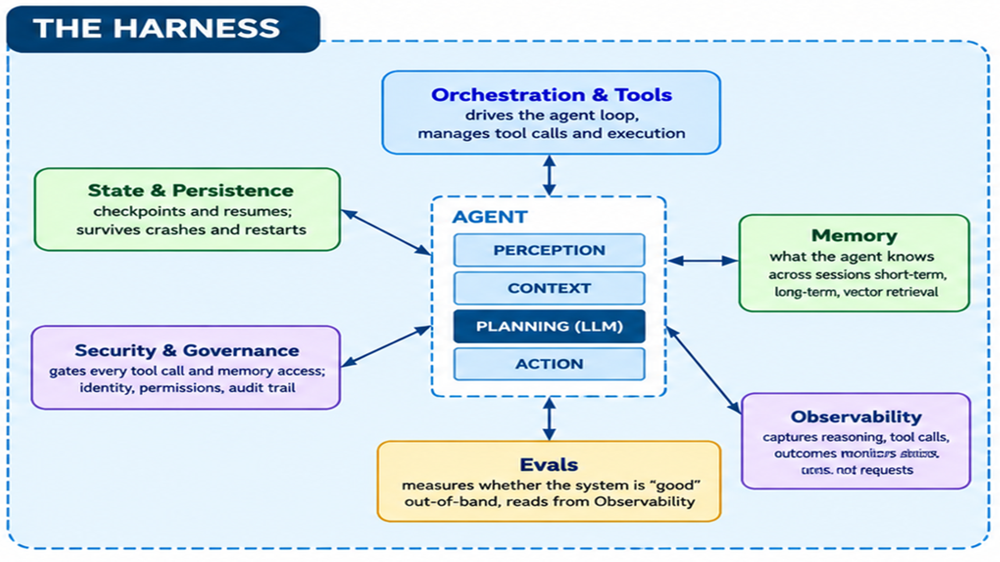

# agentic-engineering
Agentic AI Engineering ( Agentic AI Architecture, Stack, Agent Harness, Agent Orchestration, Evaluation, Observability)

## Designing an Agentic Systems / Platforms

Agentic AI represents a shift from passive, reactive AI models to autonomous systems that actively set goals, plan, and execute complex workflows with minimal or without human oversight.

Agentic AI = Systems that can plan, execute, observe and adapt complex workflows autonomously.

Agent components / AI Agent Architecture

Reasoning loop: An iterative process where the agent observes, interprets, reasons, and acts, often using prompt engineering.
Tools: Functionalities that allow the agent to interact with its environment, such as accessing and processing data or interacting with software or hardware.
Model: The brains of the AI agent, which consist of various algorithms that learn patterns from data and can make predictions or generate new content.

## 3 Layer Agentic Architecture/Model (AGENT / HARNESS / PLATFORM)

An Agent – one participant with four capabilities (perception, planning, memory, action). The system coordinates several through shared state.

A harness is the code and runtime that manages agent execution: the orchestration loop, tool calls, state, memory, security, observability, evals. A harness can run a single agent or a full agent system. What makes it a harness is that it runs as one coordinated thing.

A platform is the infrastructure that runs many harnesses across many teams over time—durable execution, fleet-wide governance, cross-harness identity, lifecycle management.

An agent has four capabilities (perception, planning, memory, action) running in a loop; A harness (Agent Runtime) is the deterministic software infrastructure and operational layer and runtime that manages agent execution, running either one agent or a full system as one coordinated runtime. harness is considered as operating system that translates the model's text-based reasoning into reliable, real-world execution. A platform, in turn, is the infrastructure that runs many harnesses across many teams over time.

Think like Agent have (LLM, Tools and Reasoning Loop) and capabilities (perception, planning, memory, action). Agent Runtime implements all capabilities like Operating system. Here Model (Sonnet, Opus is LLM) and Claude Code, Codex, Cursor is Agent Runtime.

## From Agent to Harness to Platform

### Agent
An agent is a system with four capabilities that run in a continuous loop: perception, planning, memory, and action. On each pass through the loop, the agent takes in its context, decides what to do next, draws on what it knows, and acts on the world.

### Agent Harness
An agent harness, also called the agent runtime, is the deterministic software layer that manages how an agent runs. It can run a single agent or a full multi-agent system as one coordinated runtime. A useful way to think about it is as the agent’s operating system. The model reasons in text, and the harness turns that reasoning into reliable execution in the real world.

A harness has six components. For each one, the sections below cover the problem it solves, how it works, and why it is hard to get right.

1. State and Persistence
This component stores and retrieves the agent’s execution context: checkpoints, intermediate outputs, and where the agent is within a multi-step task. If an agent crashes partway through a run, this layer decides whether it resumes from the last successful step or starts over.

Why it’s hard: Long-running agents build up state artifacts quickly. Those artifacts need the same lifecycle management as any operational data, including backup, retention, and access control.
Hidden cost: State keeps using infrastructure while an agent is paused, for example while it waits for human approval. At scale, this is a common source of unexpected cost.

2. Security and Governance
This component controls what an agent is allowed to do, whose authority it acts under, and what record its actions leave. It covers identity propagation, permission scoping, and auditability.

Why it’s hard: Most enterprise agent projects stall here before reaching production. Assurance and compliance teams expect an industry-standard set of controls for autonomous systems, and for agents that standard does not exist yet. Each organization ends up building its own controls, usually late in the project.
Three main failure modes: Data exfiltration: scoped identity is not carried through tool calls. Prompt injection: context is not sanitized. Inaccurate access control: the agent acts under a shared system identity instead of the identity of the user who made the request.

3. Orchestration and Tools
Orchestration drives the agent loop. It decides when to perceive, when to plan, when to act, and which tool to call. Tool use connects the agent to external systems such as APIs, databases, search services, and other agents.

What MCP solved: The Model Context Protocol (MCP), introduced by Anthropic in late 2024, solved connectivity. Agents can now reach tools through a common interface.
What it didn’t solve: MCP does not handle coordination, access control, rate limiting, or sandboxed execution. Most production incidents start in this gap.
Typical incident: An agent calls a tool successfully but gets back a response it wasn’t built to handle. It then loops indefinitely and keeps consuming tokens. The connection worked, but the coordination around it did not.

4. Memory
Memory works at two levels:

Agent-side (working memory): the context assembled for the current turn.
Harness-side (persistent memory): a short-term cache plus long-term episodic, conversation, and entity stores, all accessed through a vector index.

On each turn, the agent reads from the persistent store into working memory, and the action layer writes results back.

Why it’s hard: The two main infrastructure concerns are volume, because schema-free data accumulates fast, and retrieval quality, which depends on how accurate the embeddings and the vector search are.
Link to enterprise data: Agents that need to reason over existing operational data reach that data through the same entry point as the memory layer.

5. Observability
Observability records what the agent did, what it decided, what information it used, and what happened as a result.

How it differs from application monitoring: Application monitoring asks whether the system responded. Agent observability asks whether the agent’s decision was correct.
Three essential signals: The output. The reasoning trace, which shows why the agent chose that path. The memory fragments and tool calls that contributed to the decision.
Current state: As of early 2026, there is no widely accepted AgentOps playbook. Teams build their own from database observability tools, LLM observability vendors, and custom instrumentation.

6. Evals
Evals run out-of-band: they read from observability data after the fact. They decide whether an agent is ready to deploy and whether it should stay deployed. An eval suite has three parts: test cases, success criteria, and the infrastructure to run those tests repeatedly over time.

Why it’s hard: Deterministic success criteria do not map cleanly onto non-deterministic systems. Passing once is not enough, because a production agent has to work reliably across many runs.
Current state: As of early 2026, there is no widely accepted framework for evaluating agent quality. The problem of measuring agents is further along than the tools for doing it.

### Agent Platform
The six harness components sit on top of a second layer that most current discussion doesn’t name: the platform. A harness runs one agent system as a single coordinated runtime. A platform is the infrastructure that runs many harnesses, across many teams, over time. It is defined by four properties.

Durable execution. The platform keeps an agent’s work intact through process crashes and long pauses, such as a wait for human approval or a call to a slow external system. When something fails or stalls, the harness resumes from the last checkpoint instead of starting the task over. This saves compute and tokens, and it keeps multi-step work from being lost partway through.

Governance. The platform carries identity through every action and produces audit evidence automatically. Every action can then be traced back to the user or system it was done for, with a record of what happened. Because this is handled once at the platform level, each harness deployment doesn’t have to rebuild its own identity handling, permission checks, and audit logging, which would be both repetitive and error-prone.

Cost visibility. The platform reports spending for each individual agent and each individual action, not only as one total for the whole team. That makes budgets traceable: teams can see which agent, task, or tool call is driving cost and can spot expensive patterns, such as runaway loops or long idle pauses, before they grow at scale.

Data integration. The platform connects to existing enterprise systems without requiring their data to be migrated first. The harness’s memory layer can then read the operational data the organization already has, where it already lives. Agents work with current business information, and no parallel data store has to be built and kept in sync just for them.

Together, these four properties move responsibility for reliability, compliance, cost, and data access off each individual harness and onto shared infrastructure. That is what lets an organization run agents consistently across many teams over the long term.